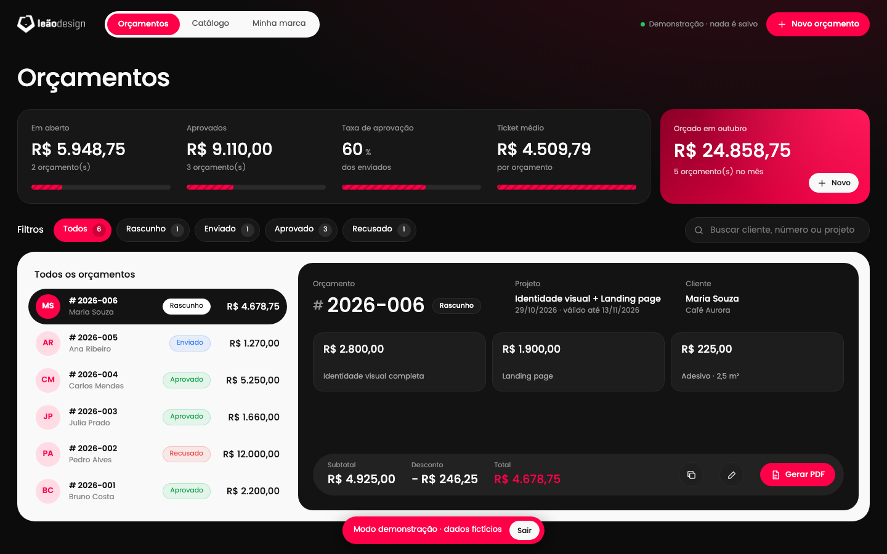
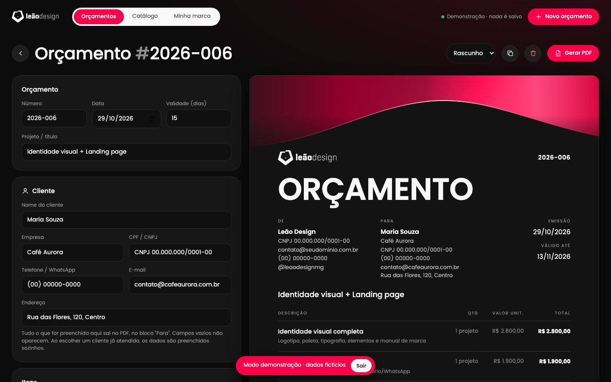
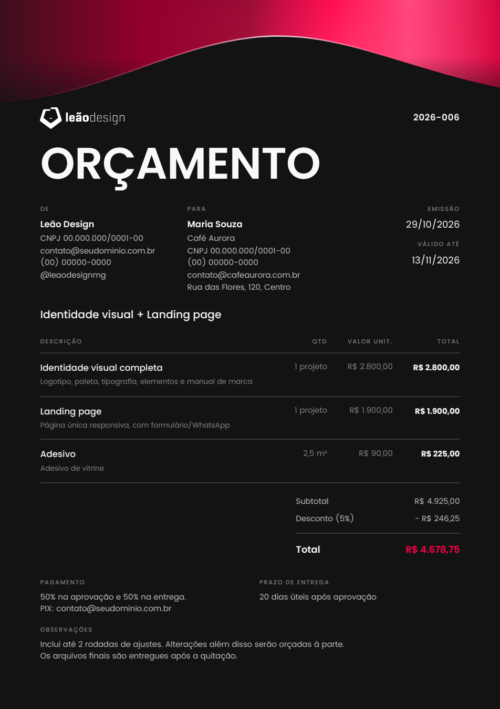
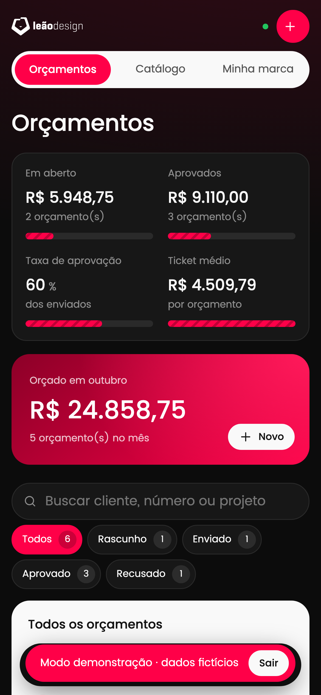
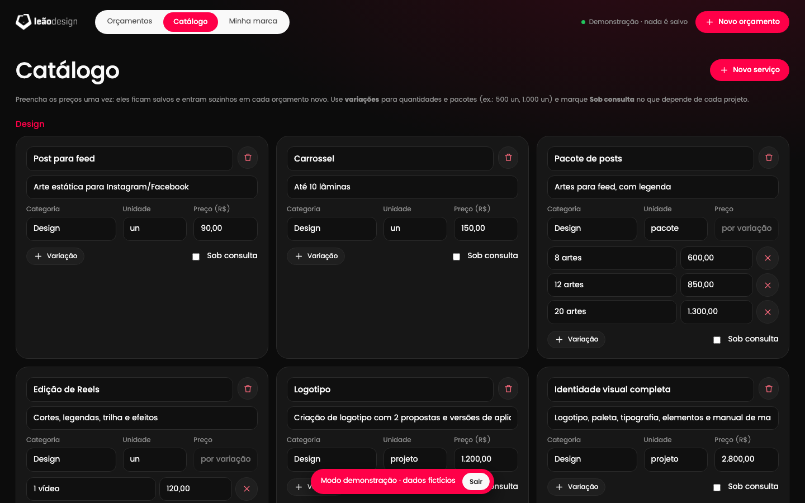

# Orçamentos · Leão Design

Sistema para criar orçamentos com a identidade visual da **Leão Design** e gerar o PDF pronto para enviar ao cliente. Funciona no Mac e no iPhone, com login e sincronização na nuvem.

**[▶ Ver demonstração ao vivo](https://orcamentos-leao-design.vercel.app/#demo)**: abre com dados fictícios, sem precisar de login, e nada é salvo.



## O que o sistema faz

- **Painel de orçamentos:** valor em aberto, aprovados, taxa de aprovação, ticket médio e total do mês, com filtros por status e busca.
- **Editor com prévia ao vivo:** o PDF é atualizado enquanto você digita.
- **Catálogo de serviços:** preços salvos uma única vez, com **variações** (por exemplo, 500 / 1.000 / 2.000 unidades ou pacotes de 8 / 12 / 20 artes) e itens **sob consulta**.
- **Clientes:** CPF/CNPJ, contato e endereço saem no PDF. Clientes já atendidos são preenchidos automaticamente.
- **PDF com a identidade da marca:** fundo escuro, onda de luz no topo, tipografia Poppins e paginação A4 automática, com cabeçalho repetido nas páginas de continuação.
- **Mac e iPhone sincronizados:** login por e-mail e senha, dados na nuvem e cópia local para continuar trabalhando sem internet.
- **App na Tela de Início do iPhone:** no celular, o PDF é gerado como arquivo e enviado pelo menu de compartilhar (WhatsApp, Arquivos, e-mail).
- **Personalizável:** logo, cores, fonte, dados da empresa, condições padrão e backup em JSON.

| Editor com prévia | PDF gerado | iPhone |
|---|---|---|
|  |  |  |



## Como foi feito

- **Front-end:** HTML, CSS e JavaScript puros, sem framework e sem etapa de build. O site inteiro é o arquivo [`web/index.html`](web/index.html).
- **Back-end:** [Supabase](https://supabase.com), com autenticação, banco Postgres e **Row Level Security**, para que cada usuário veja só os próprios dados.
- **Hospedagem:** [Vercel](https://vercel.com).
- **PDF:**
  - **No computador:** impressão do navegador. As páginas A4 são montadas em JavaScript para o resultado sair igual no Safari e no Chrome.
  - **No celular:** [html2canvas](https://html2canvas.hertzen.com) + [jsPDF](https://github.com/parallax/jsPDF).
- **Detalhes técnicos:**
  - A onda do topo é desenhada em `<canvas>` e usada como imagem, porque o Safari não imprime degradês CSS/SVG.
  - Todos os pesos da fonte são carregados antes de imprimir, porque o Safari só carrega um peso quando ele aparece na tela.
  - A sincronização envia só o que mudou e tenta de novo sozinha quando a internet volta.

### Banco de dados

Duas tabelas, ambas com RLS (`user_id = auth.uid()`):

- `settings`: marca, dados da empresa e catálogo (uma linha por usuário, em `jsonb`)
- `quotes`: um orçamento por linha (`jsonb`)

A chave do Supabase no código é a **publishable**, feita para ficar no navegador. O acesso aos dados depende do login e das regras de RLS, e o cadastro de novos usuários fica desativado.

## Rodando localmente

```bash
cd web && python3 -m http.server 8000
```

Abra `http://localhost:8000/#demo` para usar o modo demonstração.

## Créditos

- Design e desenvolvimento: **Lander Leão** · [@leaodesignmg](https://instagram.com/leaodesignmg)
- Fonte [Poppins](https://github.com/itfoundry/Poppins), sob a licença SIL Open Font License 1.1 ([licenses/Poppins-OFL.txt](licenses/Poppins-OFL.txt))
- Bibliotecas em `web/vendor/`, todas sob licença MIT: [supabase-js](https://github.com/supabase/supabase-js), [html2canvas](https://github.com/niklasvh/html2canvas), [jsPDF](https://github.com/parallax/jsPDF)

A marca Leão Design (nome, logotipo e identidade visual) pertence ao autor e não está liberada para reutilização.
